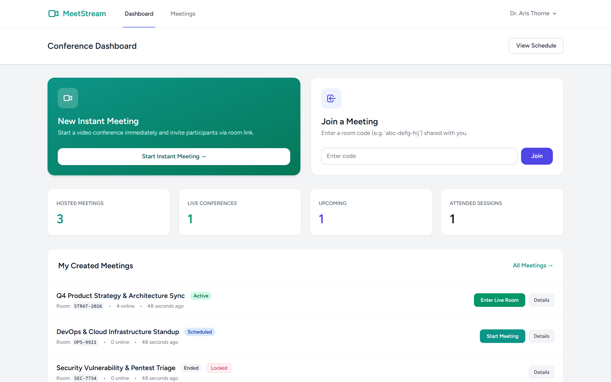
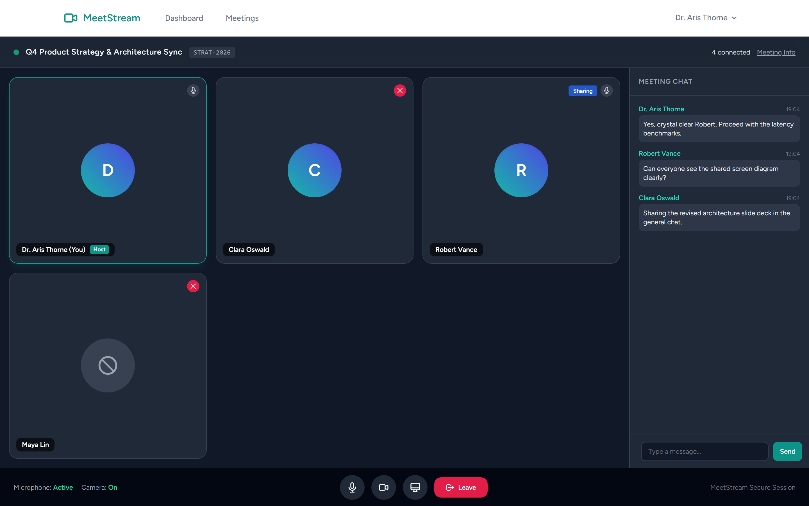
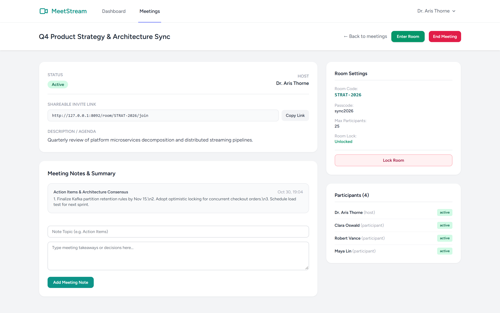
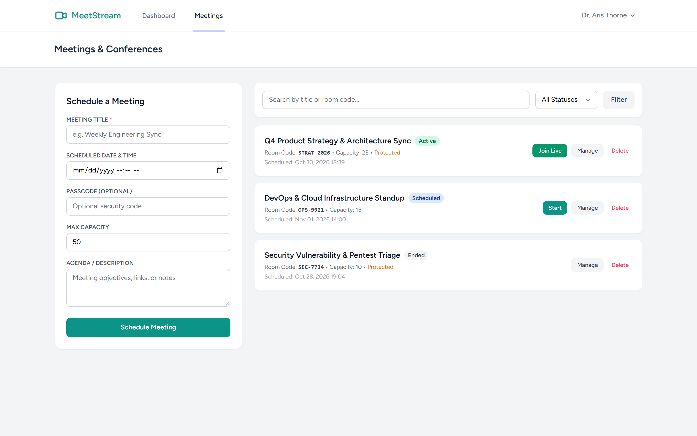

# Video Conference Platform (Laravel 12 / Breeze / Tailwind / SQLite)

A modern, real-time video conferencing platform built with Laravel, Tailwind CSS, and Blade. Features instant rooms, scheduled conferences, passcodes, lock controls, participant state management, in-meeting chat, and collaborative minutes.

## Features

- **Instant & Scheduled Meetings**: Launch instant meetings in one click with custom alphanumeric room codes or schedule meetings with capacity limits.
- **Access & Security Controls**: Optional meeting passcodes, capacity caps, and host-controlled room lock to prevent unauthorized entrants.
- **Interactive Live Conference UI**: Multi-participant responsive video grid, host badges, mute indicators, and screen-sharing indicators.
- **Dock Controls & Status**: Live mic mute toggle, camera toggle, screen share toggle, and leave conference actions.
- **In-Meeting Chat**: Integrated sidebar chat allowing real-time text collaboration during calls.
- **Meeting Notes & Summary**: Built-in collaborative minutes ledger to capture key decisions and action items.

## Screenshots

| Tampilan | Preview |
|---|---|
| **Dashboard Konferensi Video**<br>Peluncuran rapat instan satu-klik, gabung via kode ruang, ringkasan metrik sesi, dan jadwal pertemuan terdekat |  |
| **Ruang Konferensi Video Langsung**<br>Tampilan interaktif multi-peserta, indikator pembicara & berbagi layar, dock kontrol mikrofon/kamera, dan obrolan samping |  |
| **Detail Sesi Rapat & Notula Kolaboratif**<br>Pengaturan keamanan ruangan, kode akses, status kunci host, daftar kehadiran peserta, dan editor risalah rapat |  |
| **Direktori & Manajemen Pertemuan**<br>Katalog lengkap jadwal konferensi dengan filter status, pembuatan jadwal baru, dan opsi moderasi sesi |  |

---

## Tech Stack

- **Backend**: Laravel 12.x (PHP 8.3+)
- **Authentication**: Laravel Breeze
- **Database**: SQLite (local & testing), PostgreSQL ready
- **Frontend**: Blade, Tailwind CSS, Vite

## Setup & Testing

```bash
cp .env.example .env
php artisan key:generate
touch database/database.sqlite
php artisan migrate
npm install
npm run build
php artisan test
```
